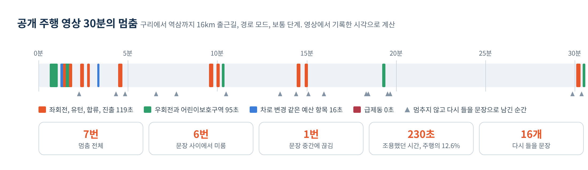

# 공개 주행 영상으로 계산한 멈춤 횟수

계산한 날은 2026년 11월 12일입니다.
실제 차량에서 잰 값이 아니라, 공개된 출근길 주행 영상에서 기록한 시각을 놓친문장의 멈춤 규칙에 넣어 계산한 값입니다.

## 영상

- 유튜브 채널 로켓독의 Driving Downtown POV - Seoul, Korea. way to work, 2020년 4월 17일 게시
- 주소: youtube.com/watch?v=HJhZTlqSyw4
- 구리시에서 역삼동까지 16km를 사람이 운전한 출근길입니다.
- 영상 처음부터 30분 30초까지 기록했습니다.

## 기록한 이벤트

기록은 `drive_video/video1.csv` 에 있습니다. 시각은 영상의 재생 시각을 초로 바꾼 값입니다.

| 종류 | 횟수 |
|---|---|
| 차로 변경 | 18 |
| 좌회전 | 5. 이 가운데 신호를 기다렸다가 돈 것이 4 |
| 유턴 | 1 |
| 우회전 | 3 |
| 어린이보호구역 | 2. 29초와 38초 |
| 직진 신호 대기 | 14. 멈춤 대상이 아니어서 기록 파일에는 넣지 않음 |

## 결과

보통 단계 기준입니다.

| 모드 | 멈춤 전체 | 문장 사이 미룸 | 중간 끊김 | 조용했던 시간 | 다시 들을 문장 |
|---|---|---|---|---|---|
| 경로 모드 | 7번 | 6번 | 1번 | 230초, 12.6% | 16개 |
| 기본 모드 | 7번 | 0번 | 7번 | 123초, 6.7% | 16개 |



- 조용했던 230초는 좌회전과 유턴 119초, 우회전과 어린이보호구역 95초, 차로 변경 16초입니다.
- 목표는 조용한 시간이 주행 시간의 10% 이하, 문장 중간 끊김이 30분에 2회 이하입니다. 이 경로에서 조용한 시간은 12.6%로 목표를 넘었고, 문장 중간 끊김은 30분에 1.0회로 목표 안입니다. 값은 고치지 않고 그대로 적었습니다.
- 차로 변경은 18번이었습니다. 예산 덕분에 멈춘 것은 2번이고 나머지 16번은 다시 들을 문장으로 남았습니다. 다시 들을 문장이 30분에 16개면 많아서 남기는 기준을 다시 정해야 합니다.
- 20분부터 29분까지는 신호 대기가 열 번 이어진 정체 구간이었지만 직진이라 한 번도 멈추지 않았습니다.

## 가정과 한계

- 영상에는 길안내 이벤트가 없습니다. 경로 모드의 값은 회전 지점을 차량 내비게이션이 미리 알려 준다고 가정한 계산입니다.
- 영상에서 속도를 읽지 못해 차로 변경은 모두 시속 40km 이상에서 일어난 것으로 보았고 하나를 5초로 두었습니다. 느린 속도에서 켠 방향지시등은 실제 앱에서 회전으로 판정되어 조용한 시간이 더 늘 수 있습니다.
- 첫 어린이보호구역은 영상이 시작될 때부터 이어지지만 차가 출발한 0분 35초부터 셌습니다.
- 유턴 직전에 기다린 시간은 0으로 두었습니다.
- 영상 한 편의 결과입니다.

## 다시 계산하는 법

```bash
python3 docs/drive_video/pause_sim.py docs/drive_video/video1.csv route
python3 docs/drive_video/pause_sim.py docs/drive_video/video1.csv basic
```

`pause_sim.py` 는 앱의 멈춤 규칙을 간단히 옮긴 계산기입니다. 차로 변경 예산은 앱과 같이 지난 30분 안에 2번, 간격 90초로 셉니다.
