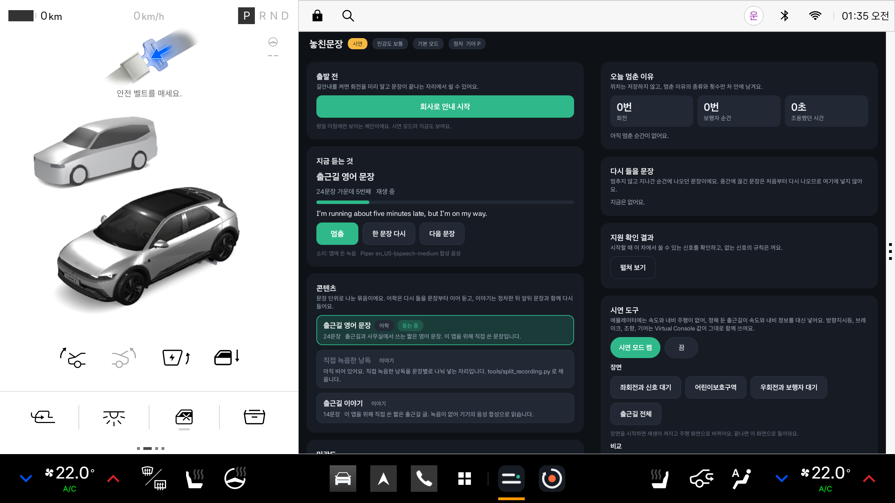
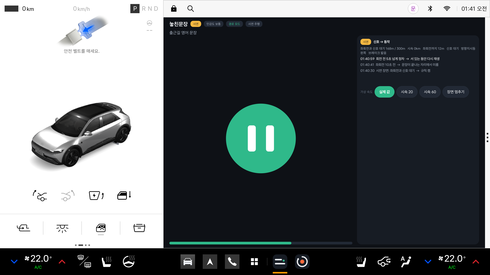
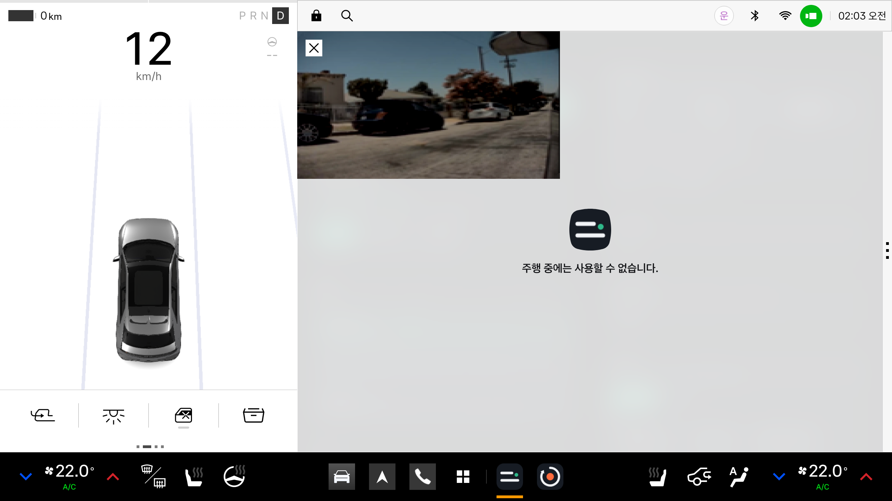

# 에뮬레이터 확인 기록

확인한 날은 2026년 11월 11일입니다. 환경은 Pleos Connect Emulator v2.1.0, Android 14 시스템 이미지입니다.
실제 차량에서는 확인하지 못했습니다. 아래 내용은 앱이 기기 기록에 남긴 상태 줄과 화면 캡처로 확인한 것입니다.

## 1. 확인한 것

| 항목 | 방법 | 결과 |
|---|---|---|
| 빌드와 설치와 실행 | `scripts/build-run.ps1` 실행 | Gradle 빌드, 설치, 실행 성공. 정차 화면 표시 |
| 방향지시등 | Virtual Console의 Turn Signal State | Vehicle SDK TurnSignal 값이 OFF, LEFT, RIGHT로 읽힘. Blink와 Flash 모두 LEFT 또는 RIGHT |
| 브레이크 페달 | Virtual Console의 BRAKE | Vehicle SDK Brake 값이 밟음과 뗌으로 읽힘 |
| 조향각 | Vehicle SDK 호출 | 값을 읽음. 핸들을 돌린 값의 변화는 아직 넣어 보지 않음 |
| 기어와 속도 | Virtual Console의 기어와 가속 페달 | AAOS Car API로 기어 P와 D, 시속 0에서 59km까지 읽음. 속도는 차량 속도 권한을 지금 쓰는 사용자에게 허용해야 읽힘 |
| 주행 규제 상태 | 기어 D | CarUxRestrictions의 규제 상태를 읽음 |
| 내비게이션 연결 | NaviHelper | 기본 내비게이션 앱과 연결됨. 회전 안내, 현재 위치, 즐겨찾기, 최근 목적지 요청이 전달됨 |
| 차량 미디어 소스 등록 | MediaBrowserService와 미디어 세션 | 차량 미디어 서비스가 놓친문장을 재생과 탐색 소스로 등록. 미디어 이전 키가 놓친문장의 세션으로 전달됨 |
| 주행 중 재생 | 기어 D에서 시속 59km까지 가속 | 앱 화면이 가려진 상태에서도 재생과 규칙이 계속 동작 |
| 차로 변경 규칙 | 시속 59km에서 왼쪽 방향지시등을 켬 | 값을 읽은 뒤 3초 안에 멈춤. 방향지시등을 끈 뒤 다시 재생 |
| 좌회전과 신호 대기 장면 | 기어 P에서 시연 모드의 장면 실행 | 아래 다섯 단계가 순서대로 일어남 |
| 지원 확인 | 앱을 시작할 때 점검 | 아홉 항목 가운데 어린이보호구역 판정만 수단이 없어 그 규칙이 꺼짐 |

### 좌회전과 신호 대기 장면

| 장면 시작 뒤 | 들어온 신호 | 앱의 동작 |
|---|---|---|
| 11초 | 좌회전까지 남은 시간이 10초 아래로 내려감 | 지금 문장이 끝나면 다음 문장을 미루기로 함 |
| 12초에서 15초 사이 | 듣던 문장이 끝남 | 다음 문장을 미루고 조용해짐 |
| 29초 | 회전 전 정차가 5초를 넘음 | 서 있는 동안 다시 재생 |
| 35초 | 브레이크 페달에서 발을 뗌 | 문장 중간에서 끊음 |
| 44초 | 회전이 끝나고 조향이 3초 동안 안정됨 | 끊긴 문장 처음부터 다시 재생 |

시각은 앱이 화면에 남긴 기록에서 읽었고, 조용해진 시각만 상태 기록의 앞뒤 값으로 범위를 적었습니다.
같은 장면을 한 번 더 돌렸을 때는 문장이 4초 안에 끝나지 않아 끊는 규칙이 동작했습니다.
이 장면의 속도, 회전 안내, 방향지시등, 브레이크 값은 시연 모드가 실제 이벤트를 처리하는 코드와 같은 경로로 넣은 값입니다.

## 2. 확인하지 못한 것과 한계

- **기어 D에서 앱 화면이 가려집니다.** 직접 설치한 앱의 화면 위에 주행 중에는 사용할 수 없다는 시스템 안내 화면이 덮입니다. 화면에 주행 중 사용 선언을 넣어도 같았고, 공식 문서의 주행 규제 해제 명령은 이 에뮬레이터에서 지원되지 않았습니다. 원인은 확인하지 못했습니다. 그래서 주행 화면은 기어 P에서 시연 장면으로 확인했습니다.
- **차량 미디어 화면 표시를 확인하지 못했습니다.** 미디어 소스 등록까지는 확인했습니다. 홈 화면의 미디어 칸에는 재생 중인 항목이 나오지 않았고, 기본 미디어 앱은 여는 데 실패했습니다.
- **길안내 중의 회전 안내 값을 받아 보지 못했습니다.** 자료형의 필드 이름이 달라도 읽을 수 있게 이름이 비슷한 값을 찾아 읽도록 만들었습니다.
- 우회전 장면, 어린이보호구역 장면, 내비 안내 음성과의 오디오 포커스는 자동 검사로만 확인했습니다.
- 개발 PC에서 에뮬레이터가 느려 앱의 판단 주기가 보통 1초 남짓, 길게는 9초까지 벌어졌습니다. 초 단위 반응 시간은 부하를 줄인 환경에서 다시 재야 합니다.

## 3. 에뮬레이터에서 찾아 고친 것

- 속도가 읽히지 않던 문제: 차량 속도 권한을 기본 사용자가 아니라 지금 쓰는 운전자 프로필 사용자에게 허용해야 했습니다. 실행 스크립트를 고치고, 앱에 권한을 다시 요청하는 버튼을 넣었습니다.
- 주행 중 앱이 응답 없음으로 종료되던 문제: 느린 에뮬레이터에서 가려진 화면을 0.2초마다 다시 그리던 것이 원인이었습니다. 글자는 바뀔 때만 고치고, 화면이 가려진 동안에는 화면 갱신을 멈추게 했습니다. 고친 뒤 같은 조건에서 종료되지 않았습니다.
- 급제동 오판: 판단 주기가 벌어졌다가 한꺼번에 값이 들어오면 급제동으로 잘못 보던 것을 1초당 감속으로 고쳤습니다.

## 4. 자동 검사

`tools/check.sh` 기준으로 규칙 엔진 109개, 재생기 67개, 앱 흐름 92개를 통과합니다.
