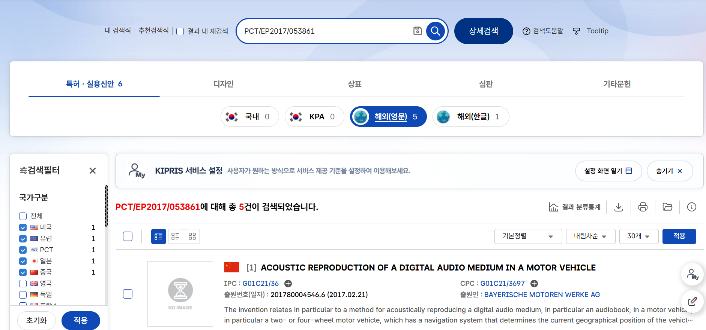
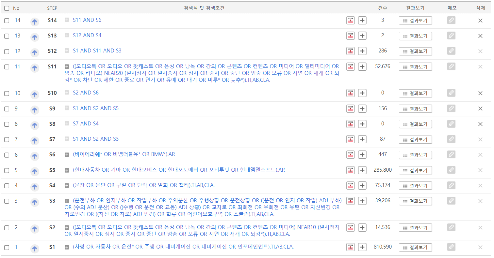

# 특허 검색 기록

검색한 날은 2026년 11월 11일이고, 검색한 곳은 특허 검색 서비스 WIPS ON과 KIPRIS입니다.
이 기록은 그날 아래 검색식으로 찾은 범위에 한정되며 법률 자문이 아닙니다. 등록과 소멸 같은 상태는 검색 서비스의 표시를 옮긴 것입니다.

## 1. BMW 오디오북 특허 두 건의 패밀리와 법적 상태

WIPS ON 번호검색으로 미국 특허 두 건을 찾고, 각 건의 패밀리 목록과 법적 상태를 확인했습니다.

| 패밀리 | 문헌 | 상태 |
|---|---|---|
| US 10448163 B2 | 미국 등록 | 등록. 2023년 4월 3일 4년차 유지료 납부. 만료 예상일 2037년 2월 21일 |
| | JP 2019-506686 A | 2022년 3월 2일 거절결정 |
| | EP 3420314 A1 | 2020년 11월 4일 취하 간주 |
| | CN 108369105 A | 2023년 3월 7일 공개 후 거절 |
| | WO2017-144437 A1 | 국제공개 |
| | DE 10-2016-202966 A1 | 심사 중. 2025년 6월 13일 심사 통지에 답변 |
| US 10448164 B2 | 미국 등록 | 등록. 2023년 4월 3일 4년차 유지료 납부. 만료 예상일 2037년 2월 21일 |
| | DE 10-2016-202968 B4 | 2025년 2월 4일 등록 확정 |
| | JP 2019-506687 A | 2021년 5월 19일 거절결정 |
| | EP 3419854 A1 | 2019년 10월 9일 취하 간주 |
| | CN 108290500 A | 2025년 8월 1일 공개 후 거절 |
| | WO2017-144446 A1 | 국제공개 |

- 두 패밀리 모두 문헌이 6건이고 한국 문헌은 없습니다.
- KIPRIS에서 국제출원번호 PCT/EP2017/053861과 PCT/EP2017/053898로 검색했을 때 국내 문헌은 두 번 모두 0건이었습니다.
- BMW가 한국에 낸 다른 출원인 공개특허 10-2023-0062437은 심사 중입니다. 대표 청구항은 운전과 관련 없는 인포테인먼트 콘텐츠 요청을 감지하면 차량 안전 기능을 먼저 자동으로 켠 뒤 콘텐츠를 내보내는 장치입니다.

## 2. 한국 특허와 실용신안 단계별 검색

검색 조건은 국가 한국, 문헌 종류 공개와 등록과 실용, 검색 언어 한국어와 영어입니다.

| 단계 | 검색식 | 건수 |
|---|---|---|
| S1 | (차량 OR 자동차 OR 운전* OR 주행 OR 내비게이션 OR 네비게이션 OR 인포테인먼트).TI,AB,CLA. | 810,590 |
| S2 | ((오디오북 OR 오디오 OR 팟캐스트 OR 음성 OR 낭독 OR 강의 OR 콘텐츠 OR 컨텐츠 OR 미디어) NEAR10 (일시정지 OR 일시중지 OR 정지 OR 중지 OR 중단 OR 멈춤 OR 보류 OR 지연 OR 재개 OR 되감*)).TI,AB,CLA. | 14,536 |
| S3 | (운전부하 OR 인지부하 OR 작업부하 OR 주의분산 OR 주행상황 OR 운전상황 OR ((운전 OR 인지 OR 작업) ADJ 부하) OR (주의 ADJ 분산) OR ((주행 OR 운전 OR 교통) ADJ 상황) OR 교차로 OR 좌회전 OR 우회전 OR 유턴 OR 차선변경 OR 차로변경 OR ((차선 OR 차로) ADJ 변경) OR 합류 OR 어린이보호구역 OR 스쿨존).TI,AB,CLA. | 39,206 |
| S4 | (문장 OR 문단 OR 구절 OR 단락 OR 발화 OR 챕터).TI,AB,CLA. | 75,174 |
| S5 | (현대자동차 OR 기아 OR 현대모비스 OR 현대오토에버 OR 포티투닷 OR 현대엠엔소프트).AP. | 285,800 |
| S6 | (바이에리쉐* OR 비엠더블유* OR BMW*).AP. | 447 |
| S7 | S1 AND S2 AND S3 | 87 |
| S8 | S7 AND S4 | 0 |
| S9 | S1 AND S2 AND S5 | 156 |
| S10 | S2 AND S6 | 0 |
| S11 | ((오디오북 OR 오디오 OR 팟캐스트 OR 음성 OR 낭독 OR 강의 OR 콘텐츠 OR 컨텐츠 OR 미디어 OR 멀티미디어 OR 방송 OR 라디오) NEAR20 (일시정지 OR 일시중지 OR 정지 OR 중지 OR 중단 OR 멈춤 OR 보류 OR 지연 OR 재개 OR 되감* OR 차단 OR 제한 OR 종료 OR 연기 OR 유예 OR 대기 OR 미루* OR 늦추*)).TI,AB,CLA. | 52,676 |
| S12 | S1 AND S11 AND S3 | 286 |
| S13 | S12 AND S4 | 2 |
| S14 | S11 AND S6 | 3 |

- S10이 0건이어서 S2의 멈춤 표현이 좁다고 보고 S11로 넓혔습니다. 넓힌 식은 BMW의 한국 출원을 찾아냈습니다.
- S12의 286건은 같은 출원의 공개 문헌과 등록 문헌을 따로 센 수이고 출원으로는 228건입니다. S9의 156건은 출원으로 121건입니다.
- 읽은 방법: S12와 S9의 제목을 모두 훑었고, 가까워 보이는 35건은 요약과 대표 청구항을 읽었습니다. 나머지는 교차로 경보, 횡단보도 안전, 신호등, 교통정보 방송처럼 차 안 콘텐츠 재생과 관계없는 발명이었습니다.

### S13의 2건

| 번호 | 발명 | 출원인 | 상태 | 판단 |
|---|---|---|---|---|
| 공개 10-2025-0041231 | 차량의 가속페달 오조작 방지 방법 및 그 시스템 | 현대자동차, 기아 | 심사 중 | 급가속과 차속 제한에 관한 발명. 콘텐츠 재생과 관계없음 |
| 공개 10-1987-0004588 | 무선 교통 정보 복호장치 | 로베르트 보쉬 | 소멸 | 교통 방송 수신기. 관계없음 |

검색한 범위 안에서는 다가오는 주행 상황을 읽어 말소리 콘텐츠를 문장이 끝나는 자리에서 미루고 이어 가는 구성을 청구한 한국 문헌을 찾지 못했습니다.

## 3. 가장 가까운 한국 문헌

### 현대자동차그룹의 문헌

| 번호와 이름 | 출원인과 권리자 | 출원일 | 상태 | 내용 | 놓친문장과 다른 점 |
|---|---|---|---|---|---|
| 등록 10-0257024 어학 학습이 편리한 카오디오 | 현대자동차 | 1997년 12월 20일 | 소멸. 등록료 불납 | 차속, 조향각, 제동 유압 신호로 급코너링과 급제동을 판단해 어학용 카세트 테이프를 잠시 멈춤 | 닥친 뒤에 멈춤. 미리 알지 못하고 문장 단위가 없음 |
| 등록 10-0967926 차량의 교통상황과 연계한 컨텐츠 제어 방법 | 현대엠엔소프트 출원, 현재 권리자 현대오토에버 | 2008년 7월 1일 | 등록 | 교통정보와 주행 속도로 교통상황을 판단해 음악, 게임, 영화의 재생 방법을 제어 | 정체 여부와 속도가 기준. 회전이나 보행자 순간, 문장 경계가 없음 |
| 등록 10-2339167 안전운전 지원 방법 및 장치 | 현대모비스 | 2014년 10월 31일 | 등록 | 사고다발 구간이나 공사구간, ABS와 와이퍼의 작동, 주변 소음으로 집중 운전 조건을 판단해 청각 부담을 주는 음성을 조절 | 음성을 조절. 문장이 끝나는 자리에서 미루고 이어 가는 구성이 없음 |
| 등록 10-2939672 콘텐츠 디스플레이 방법 및 그 장치 | 현대오토에버 | 2022년 6월 22일 | 등록 | 교차로 신호 대기 시간을 계산해 그 길이에 맞는 콘텐츠를 골라 표시 | 대기 시간에 맞는 콘텐츠를 고름. 듣던 콘텐츠를 이어 주는 것이 아님 |
| 공개 10-2017-0007045 정차 시간 예측 기반 컨텐츠 재생 | 현대자동차 | 2015년 7월 10일 | 거절 | 경로의 정차 예상 시간을 계산해 정차하는 동안 재생할 콘텐츠를 고름 | 위와 같음 |
| 공개 10-2024-0173925 차량 제어 장치 및 그 방법 | 현대자동차, 기아 | 2023년 6월 7일 | 심사 중 | 자율주행 가능 시간을 알려 주고 자율주행 중일 때 멀티미디어 재생을 허용 | 자율주행 여부가 기준 |

### 다른 회사의 인접 문헌

| 번호와 이름 | 출원인 | 상태 | 내용 | 놓친문장과 다른 점 |
|---|---|---|---|---|
| 등록 10-2606026 상황 인식 개인 비서 | 마이크로소프트 | 등록 | 센서로 상황 점수를 계산해 음성 비서와 사용자의 상호작용을 중지했다가 재개 | 묻고 답하는 비서가 대상. 콘텐츠 재생기가 아님 |
| 등록 10-1749315 차량 인터페이스를 제공하는 단말기 | 인포뱅크 | 등록 | 첫째 기능의 중요 이벤트 동안 둘째 기능의 실행 요청을 미루고, 지연을 보상하는 부가 기능을 실행한 뒤 재개 | 새로 요청된 기능의 실행을 미룸 |
| 등록 10-2479072 디스트랙션 확인을 통한 컨텐츠 표시 방법 | 삼성전자 | 등록 | 운전 상황이면 운전석 화면 대신 다른 화면에 콘텐츠를 표시 | 화면 선택 |
| 공개 10-2023-0062437 | BMW | 심사 중 | 안전 기능을 먼저 자동으로 켠 뒤 콘텐츠 출력 | 안전 기능 자동 활성화가 요소 |

## 4. 정리

- BMW의 오디오북 특허 두 건은 패밀리에 한국 문헌이 없습니다. 살아 있는 권리는 미국 2건과 독일 1건입니다.
- 운전 상황에 맞춰 어학 콘텐츠를 멈춘다는 발상은 현대자동차가 1997년에 먼저 특허로 냈고 그 권리는 소멸했습니다. 가장 가까운 한국 등록 특허 세 건도 현대오토에버와 현대모비스의 것입니다.
- 놓친문장이 더하는 것은 닥치기 전에 미리 아는 것, 문장이 끝나는 자리에서 쉬는 것, 끊긴 문장을 처음부터 다시 들려주고 멈춤 횟수를 관리하는 것입니다.

## 5. 한계

- 해외 특허는 BMW 두 건의 패밀리만 확인했고 단계별 검색은 하지 않았습니다.
- 마이크로소프트와 인포뱅크의 등록 특허는 대표 청구항만 읽었습니다.
- 등록 특허의 등록료 납부와 존속 여부는 검색 서비스의 상태 표시만 확인했습니다.
- 출시 전에는 위 등록 특허들과 미국, 독일의 BMW 특허에 대해 전문가 검토가 필요합니다.
